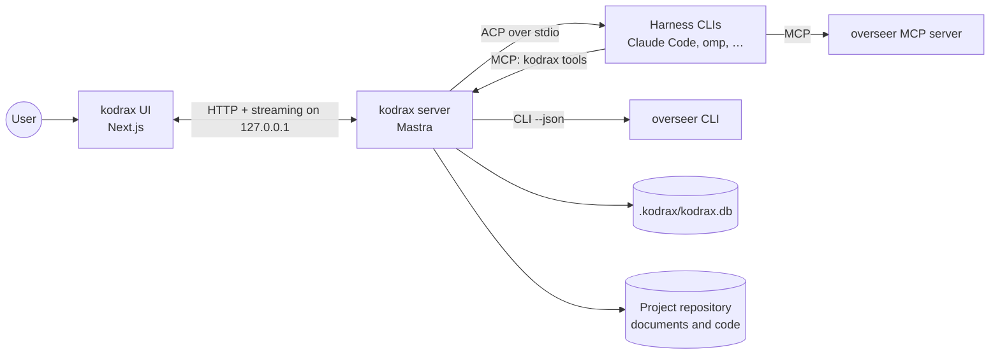

# 0006. Local runtime: separate server and UI

- **Status**: Accepted, with open questions
- **Date**: 2026-10-24
- **Scope**: the processes kodrax runs, where they run and how they are started.

## Context

kodrax's server side keeps durable agent runs, long-lived harness processes speaking ACP over stdio, file watchers and indexing jobs. Next.js route handlers suit request-and-response work and fit those poorly. kodrax runs on the user's machine, because the harness subscriptions it uses belong to that user ([ADR 0009](0009-subscription-first-authentication.md)).

## Decision

1. kodrax runs two processes:
   - **kodrax server**: Mastra. Workflows, storage, the MCP server that harness sessions use, ACP clients, the overseer bridge and indexing.
   - **kodrax UI**: Next.js. Chat, progress, documents, board, approvals. It talks to the server over HTTP with streaming.
2. Both run on the user's machine and listen on `127.0.0.1` only. The server rejects requests whose `Host` isn't local, and writes need a token created at each start, as overseer's board does.
3. Both ship in the `kodrax` npm package, whose `kodrax` command ([ADR 0001](0001-product-name.md)) starts, stops and checks them. Installing kodrax in a project adds nothing to that project's `package.json`.
4. One kodrax server per machine serves every registered project, so one concurrency and quota budget per subscription applies across projects, and the UI shows every project. *Resolved 2026-10-24.*

## Options considered

| Option | Result |
|---|---|
| Separate Mastra server and Next.js UI, both local | **Chosen.** |
| Mastra inside Next.js route handlers | Rejected. Long-lived child processes and durable runs don't fit the request model. |
| A hosted service | Out of scope. Subscriptions belong to individual users and run on their machines. |
| One server per project | Rejected on 2026-10-24. Simpler to isolate, but it can't keep one quota budget per subscription across projects. |

## Consequences

- Two processes to supervise, ports to manage and a version handshake between them.
- The UI reaches only what the server exposes, which keeps the security surface in one place.
- An interface for other agents (a pending decision) would be added to the server.

## Open questions

1. **Ports**: a default port with a fallback range, as overseer uses 4477–4496.
