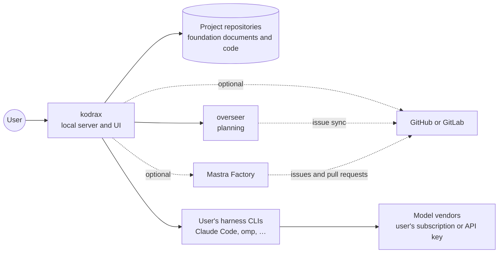
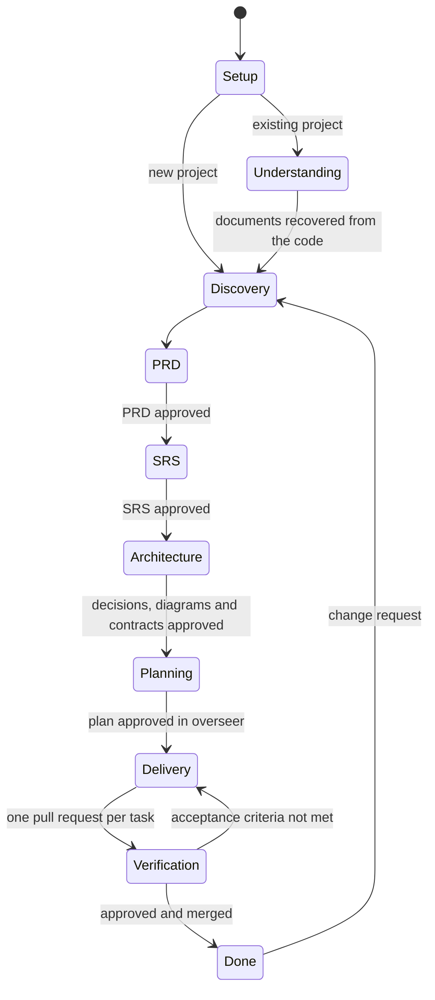

# kodrax: product requirements

- **Status**: Draft 0.2
- **Date**: 2026-10-24
- **Decisions**: [decision records](../decisions/README.md)
- **Requirements**: [SRS](../requirements/srs.md)

This document says what kodrax is, who it is for and what it must do. The SRS turns it into verifiable requirements. Where this draft and an accepted decision record disagree, the decision record wins until this document is updated.

## 1. Summary

kodrax is a local agent harness, built with Mastra and Next.js, that takes a software project from idea to delivery. It talks with the user to define the product (PRD, SRS, architecture, contracts), plans the work in overseer, has the user's coding harnesses (Claude Code, omp and others) build it in isolated worktrees, and checks the result against the documents. It installs into an existing project without disrupting it, or starts a new project from nothing, and in both cases it works on the project's repositories as a maintainer or a contributor.

## 2. Problem

- Coding harnesses are good at changing code and weak at keeping a product's definition. Requirements stay in chat history, decisions get lost, and nothing checks that the code still matches what was agreed.
- Tools that automate delivery, such as Mastra Factory, start from issues. Someone still has to define the product and turn it into ordered, well-scoped issues.
- Large projects outgrow a model's context, while small ones have little to retrieve. Few tools change how they understand a project as it grows.

## 3. Principles

1. **The documents are the truth.** Committed foundation documents define the product, and code is checked against them ([ADR 0002](../decisions/0002-foundation-documents-are-the-source-of-truth.md)).
2. **Local and non-disruptive.** kodrax runs on the user's machine, adds only its documents and a `.kodrax/` folder to a project, and keeps the project's repository structure ([ADR 0003](../decisions/0003-documentation-folder-and-management-modes.md), [ADR 0006](../decisions/0006-local-runtime.md), [ADR 0015](../decisions/0015-repository-roles.md)).
3. **Bring your own harness.** kodrax reasons and builds through the harness subscriptions the user already has, from any vendor ([ADR 0007](../decisions/0007-harness-connection-acp-first.md), [ADR 0008](../decisions/0008-harness-as-the-brain.md), [ADR 0009](../decisions/0009-subscription-first-authentication.md)).
4. **The user stays in control.** Approvals by default; autonomy is opt-in ([ADR 0013](../decisions/0013-approvals.md)).
5. **Safe by default.** A worktree for every change and security checks on; kodrax and each of its capabilities can be turned off ([ADR 0012](../decisions/0012-worktrees-and-sandboxes.md), [ADR 0014](../decisions/0014-optional-capabilities.md)).
6. **Use, don't rebuild.** Planning is overseer's job, and issue-to-pull-request execution can be Mastra Factory's ([ADR 0005](../decisions/0005-planning-through-overseer.md), [ADR 0010](../decisions/0010-mastra-factory-optional-backend.md)).

## 4. Users

To be confirmed (open question 1). Working hypotheses:

| User | Situation | What they need from kodrax |
|---|---|---|
| Builder starting from zero | An idea and a harness subscription, no code | A discovery conversation, documents, a plan, the first applications scaffolded in the layout the architecture decides, delivery |
| Developer on an existing project | Code exists; documentation is partial or stale | An understanding of the project, documents recovered from the code, a plan for new work, drift checks |
| Lead of a small team | Several people and harnesses on the same repositories | Documents shared in git, a plan shared through overseer's issue sync, approvals by role |

Solo use and team use differ in what has to be shared between people:

| Topic | One person | A team |
|---|---|---|
| kodrax instances | One, on that person's machine | One per person, each on its own machine and subscriptions, working on the same repositories |
| Foundation documents | Changes come from one place | Changes arrive from several people at once, so they go through pull requests to avoid conflicts |
| Plan | overseer's local database is enough | overseer's database is per clone, so the shared plan lives in GitHub or GitLab issues through overseer's sync, and each task needs an owner so two instances don't take it |
| Approvals | The same person approves everything | Gates belong to roles (product owner, technical lead, reviewers), and an approval given in one person's kodrax must be visible to the others, for example as a pull request review |
| Identity on the host | The user's own credentials can work | A kodrax identity with a role per repository keeps kodrax's actions apart from each person's ([ADR 0015](../decisions/0015-repository-roles.md)) |
| Subscriptions | One | One per person; never pooled (ADR 0009) |

## 5. Scope

### 5.1 Lifecycle

### 5.2 Capabilities

| Area | What kodrax does | Decisions |
|---|---|---|
| Setup | The `kodrax` command sets kodrax up in a new or existing folder. It asks for the documentation folder, the management mode, the harnesses for the brain and the implementers, the repository role and the capabilities, then registers the project with the local server. kodrax can be turned off and on per project. | 0003, 0006, 0014, 0015 |
| Conversation | A chat UI with the brain: questions, proposals, decisions and progress. | 0008 |
| Definition | PRD, SRS (EARS requirements with acceptance criteria), decision records, architecture diagrams, contracts and schemas, in managed or propose mode. | 0002, 0003 |
| Understanding | A knowledge index of documents and code that follows their changes and grows with the project; documents recovered from an existing codebase. | 0004 |
| Planning | Requirements projected into overseer; epics, stories and tasks with dependencies and order; coverage and drift. | 0005 |
| Delivery | One implementer session per task in its own worktree, on the user's harness; optional sandboxes; optional Mastra Factory backend; pull requests. | 0007, 0010, 0012 |
| Verification | Acceptance criteria against tests, contracts against code, the SRS against overseer; drift reports. | 0002 |
| Repositories and security | Work on the project's repositories as a maintainer or a contributor: branches, pull requests, merges for maintainers; secret scanning, dependency audit, static analysis. | 0014, 0015 |
| Control | Approval queue, auto-approval rules, audit log, quota and rate-limit view. | 0009, 0013 |
| Harnesses | Claude Code and omp in the first release; a registry of harnesses with their capabilities and vendor terms; sign-in through each harness's own flow. | 0007, 0008, 0009 |

### 5.3 UI surfaces

Chat; project overview and progress timeline; documents with rendered diagrams and pending proposals; board (overseer's data); approval queue; harness sessions with live output, diffs and commands; knowledge search; settings (folder, mode, capabilities, harnesses, limits).

### 5.4 Out of scope for the first release

- A hosted or multi-tenant kodrax.
- A coding agent loop or model access of kodrax's own; reasoning and coding happen in the user's harnesses.
- An interface for other agents and systems (pending decision).
- Reorganising a managed project's repositories into a layout of kodrax's (ADR 0015).
- Replacing overseer or Mastra Factory.

## 6. Constraints

- Mastra for the server and Next.js for the UI, both running locally (ADR 0006).
- Node.js ≥ 22.18, which overseer requires.
- Each vendor's terms for subscription use (ADR 0009).
- Projects live in git repositories.

## 7. Success measures

Candidates to agree on (open question 3):

- Setting kodrax up in an existing project changes nothing outside the documentation folder and `.kodrax/`.
- Every requirement in the SRS has acceptance criteria and traces to overseer work and to tests.
- Time from the first message to an approved SRS for a small product.
- Share of delivered tasks accepted without rework.
- Open drift items per release.

## 8. Risks

| Risk | Mitigation |
|---|---|
| Vendor terms on subscription use tighten | API-key option; terms checked per adapter and release (ADR 0009); [harness landscape](../research/harness-landscape.md) timeline |
| A vendor drops or replaces its CLI, as Google did with Gemini CLI | Capability-based adapters and a generic ACP adapter (ADR 0007, ADR 0008) |
| Subscription limits stall long runs | Pacing, pause and resume, quota view (ADR 0009) |
| kodrax's prompts behave differently per harness | Prompt tests per supported adapter (ADR 0008) |
| An agent reading untrusted text tries to get risky actions approved | Approval policy changed only by the user; tiers for critical actions (ADR 0013) |
| Overlap with fast-moving Mastra products (Factory, Harness) | Use their public interfaces; keep kodrax's value in definition, planning and verification (ADR 0010) |

## 9. Open questions

1. Who are the first users: one person, teams, or both? Section 4 shows what changes.
2. How kodrax handles a project with several repositories ([ADR 0015](../decisions/0015-repository-roles.md), open question 3).
3. Success measures and their targets.
4. The [pending decisions](../decisions/README.md#pending-decisions) and the [SRS open issues](../requirements/srs.md#6-open-issues).
